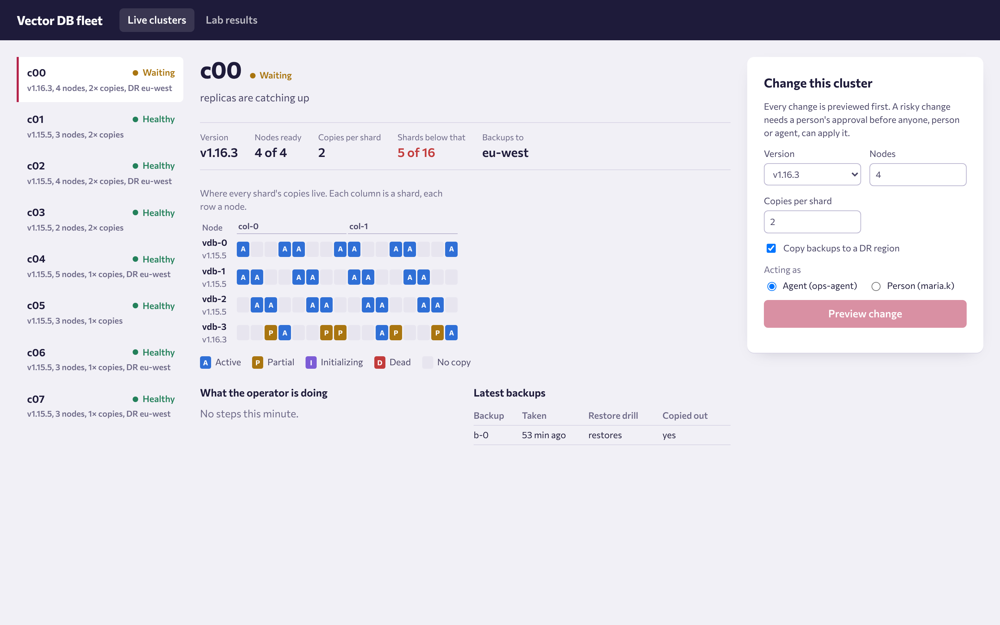
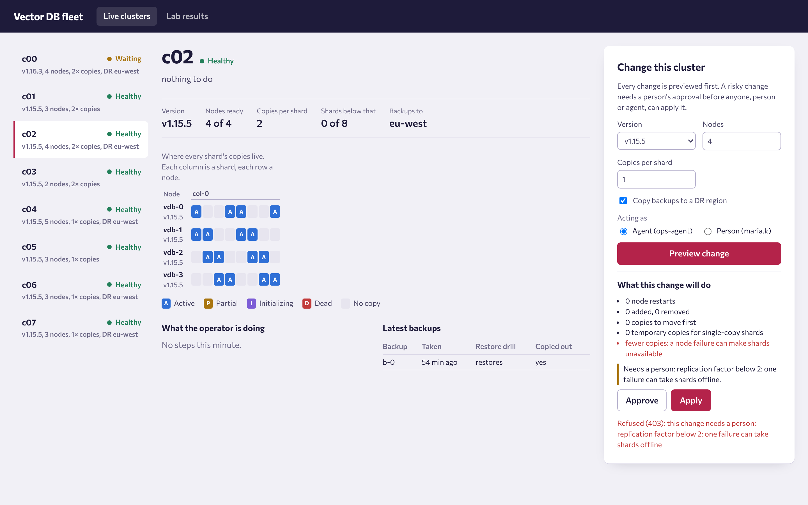
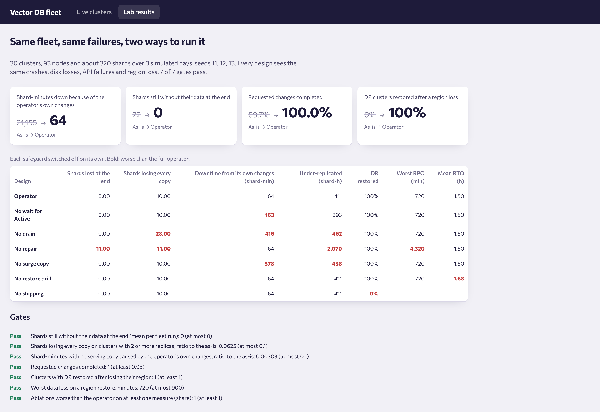

# vector-db-lifecycle-operator

A Kubernetes operator in Go for a distributed vector database (Qdrant): provisioning, scaling with shard rebalancing, rolling upgrades, repair after crashes and disk loss, backups with restore drills, and copies shipped to a disaster-recovery region. Changes go through an agent-safe API: preview, a person's approval for risky changes, and an idempotent apply.

One planner makes every decision. The same function runs in three places:

- **the lab**: a simulated fleet with failures the planner cannot see in advance, so designs can be compared on the same luck;
- **the operator** (`operator/`): controller-runtime, pods and volumes on Kubernetes, the database's own cluster API for shard moves. CI runs it end to end on kind against real Qdrant images;
- **the change API and console**: a person or an AI agent previews a change, sees what it will do, and applies it once.

```
          spec (VectorCluster / change API)
                     │
   observed ──► plan.Plan(spec, observed, safeguards) ──► one step at a time
 (nodes, shards,               pure, no I/O                (create, restart, copy,
  transfers, backups)                                       drop, delete, back up, restore)
```

## Results

<!-- results:start -->
_Generated by `go run ./cmd/lab dev` from `reports/*.json`; do not edit by hand._

**Dev fleet:** 30 clusters, 93 nodes, about 320 shards, 3 simulated days per run; 60 upgrades, 16 scale-ups, 19 scale-downs requested; 14 clusters with a DR region; seeds [11 12 13]. Gates: 7 of 7 pass.

- **As-is**: As found: a StatefulSet and a backup cron job. Pods restart in order when the previous one is Ready, scale-down deletes the highest pod, snapshots are never tested or copied out of the region.
- **Operator**: The operator: shard-aware rolling restarts, temporary copies for single-copy shards, drain before delete, repair, rebalance, restore-tested backups shipped to the DR region.

| Measure (mean of 3 fleet runs) | As-is | Operator |
|---|---:|---:|
| Availability (share of shard-minutes with a serving copy) | 0.9678 | 0.9981 |
| Shard-minutes with no serving copy, caused by the operator's own changes | 21155 | 64 |
| Shard-minutes with no serving copy, all causes | 52932 | 3169 |
| Shards losing every copy on clusters with 2+ replicas | 5.33 | 0.33 |
| Shards losing every copy, all clusters | 22.00 | 10.00 |
| Shards restored from a backup | 0.00 | 10.00 |
| Shards still without their data at the end | 22.00 | 0.00 |
| Under-replicated shard-hours | 3002 | 411 |
| Requested changes completed (share) | 0.897 | 1.000 |
| Mean minutes per change | 9.5 | 69.6 |
| DR clusters restored after losing their region (share) | 0.00 | 1.00 |
| Worst data loss on a region restore (minutes) | – | 720 |
| Mean time to restore a region (hours) | – | 1.50 |
| Temporary copies during upgrades (GB-hours) | 0 | 12700 |

**Each safeguard switched off on its own** (bold = worse than the full operator):

| Design | Lost at end | Loss events | Unavailable by ops (shard-min) | Under-replicated (shard-h) | DR restored | Worst RPO (min) | Mean RTO (h) |
|---|---:|---:|---:|---:|---:|---:|---:|
| Operator | 0.00 | 10.00 | 64 | 411 | 1.00 | 720 | 1.50 |
| No wait for Active | 0.00 | 10.00 | **163** | 393 | 1.00 | 720 | 1.50 |
| No drain | 0.00 | **28.00** | **416** | **462** | 1.00 | 720 | 1.50 |
| No repair | **11.00** | **11.00** | 64 | **2070** | 1.00 | **4320** | 1.50 |
| No surge copy | 0.00 | 10.00 | **578** | **438** | 1.00 | 720 | 1.50 |
| No restore drill | 0.00 | 10.00 | 64 | 411 | 1.00 | 720 | **1.68** |
| No shipping | 0.00 | 10.00 | 64 | 411 | **0.00** | – | – |

_The held-out fleet has not been run yet._
<!-- results:end -->





## What the planner does

In this order, on every look, and it only takes the next safe step:

1. **Create** nodes the spec asks for.
2. **Repair** before anything else, most at-risk shards first, in parallel on nodes that are not already copying. A node down for a few minutes is waited out (`repairAfter`, 15 min); a longer outage or a lost disk is re-replicated. A shard with no surviving copy is restored from the newest backup that passed a restore drill.
3. **Wait** while copies are in flight, a node is not ready, or a replica is still catching up (Partial). Ready pods are not enough; replicas must be Active.
4. **Scale down** from the highest node: drain first (copy its shards elsewhere, then drop them), then remove the peer and the node.
5. **Upgrade** one node at a time, highest first. Before restarting the only copy of a shard, make a temporary copy and drop it afterwards.
6. **Rebalance** surplus copies and uneven nodes.
7. **Back up** on schedule, run a restore drill on each new backup, ship the newest trusted one to the DR region, prune by retention.

Each step can be switched off in `config/designs.json`; the lab shows what each one is worth.

## The agent-safe change API

`go run ./cmd/api` serves a simulated fleet of 8 clusters (port 8080).

| Call | What it does |
|---|---|
| `POST /v1/clusters/{id}/changes/preview` | Checks a change and returns what it will do: restarts, nodes added or removed, copies to move, temporary copies, risks, and whether a person must approve it. |
| `POST /v1/changes/{pid}/approve` | A person approves. An agent gets 403. |
| `POST /v1/changes/{pid}/apply` | Needs an `Idempotency-Key`. A replay returns the same answer and changes nothing. A preview made against an older generation is refused with 409. An agent applying a change that needs a person, unapproved, gets 403. |
| `GET /v1/agent-tools` | The same calls as tool definitions an agent (MCP or function calling) can load. |

A person must approve: a downgrade, skipping a minor version, fewer than 2 copies per shard, fewer nodes than copies, a node count change of more than 2, or removing DR.

## Run it

```bash
go test ./...                       # planner, simulator, lab, API, Qdrant client
go run ./cmd/lab dev                # dev fleet: writes reports/dev.json, REPORT.md, this README's results, web/public/data
go run ./cmd/lab gate dev           # fails if a gate fails
go run ./cmd/api                    # change API over a simulated fleet
cd web && npm ci && npm run dev     # console on :5173, talks to :8080

# operator (needs Go module access; CI does this)
cd operator && go test ./... && go build ./...
docker build -f Dockerfile.operator -t vdb-operator:dev .
kind create cluster --name vdb && kind load docker-image vdb-operator:dev --name vdb
operator/e2e/run.sh                 # provision, write points, upgrade under reads, crash a pod, scale down
```

The held-out fleet (harsher faults, other seeds) runs once: `go run ./cmd/lab heldout` writes `reports/heldout.lock` first and refuses to run again.

## Layout

| Path | What |
|---|---|
| `internal/plan` | The planner. Pure: spec + observation + safeguards in, one decision out. |
| `internal/sim` | The simulated cluster with its own truth: crash schedules, disk loss, API and transfer failures, backups that do not restore, region loss. |
| `internal/lab` | Fleet, designs, gates, reports, the held-out lock. |
| `internal/api` | The change API. |
| `internal/qdrant` | REST client for Qdrant's cluster API (peers, shards, transfers, replicate, drop, snapshots, remove peer). |
| `operator/` | controller-runtime operator: `VectorCluster` CRD, reconciler, manifests, kind e2e. |
| `web/` | Console: live fleet with a shard map, change preview and apply, lab results. |
| `config/` | World, designs, seeds, gates. Nothing tunable lives in code. |
| `docs/adr` | Decisions. |

## Limits

- **The fleet results are simulated.** Failure rates, transfer speeds and restore times are assumptions in `config/world.json`, not measurements from a production fleet. The numbers compare designs on the same luck; they do not predict a real fleet's availability.
- **The operator runs a subset of the plan on Kubernetes.** Create, restart (upgrade), delete with drain, repair by re-replication and rebalancing run against real Qdrant. Backups, restore drills, shipping to a DR region and restoring a lost shard are planned and measured in the lab only; the adapter skips those steps. A replaced node with a lost disk joins as a new peer; the old peer is not removed from consensus yet.
- **The e2e is small.** Three nodes, one collection, a few hundred points, one minor-version upgrade, on kind in CI. It shows the mechanics, not behaviour under load.
- **No auth on the change API.** The actor is taken from the request body; a real deployment puts it behind the identity of the caller.
- **This is a portfolio project.** Go, Kubernetes operators and Qdrant here are my own work outside an employer.
